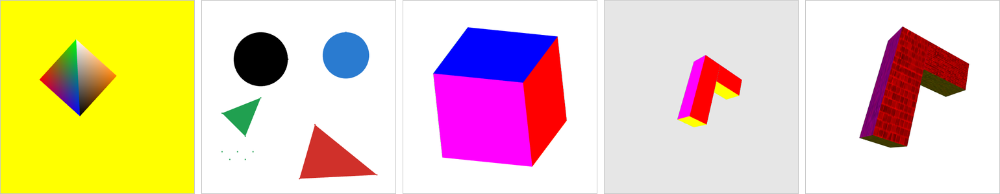

# 🎨 WebGL2 Graphics Fundamentals

Five small WebGL2 demos that go from 2D matrices to lit, textured 3D objects. Each one is a standalone page in its own folder, written in plain JavaScript and GLSL with no libraries or build step. The root page is a gallery that links to all of them.

**Live demo:** https://pgerasymchuk.github.io/webgl2-graphics-fundamentals/



🎓 Made for the Computer Graphics course at Igor Sikorsky Kyiv Polytechnic Institute (3rd year, spring 2025).

## Demos

| Demo | What it shows | Controls |
|------|---------------|----------|
| [2D Transformations](2d-transformations/) | 3×3 matrices in pixel space, per-vertex colours, animation | "Toggle second triangle" button; links to part 2 |
| [2D Shapes](2d-shapes/) | Interactive drawing of points, triangles and circles | Mode buttons, mouse clicks, colour picker, clear |
| [Cube Projection](cube-projection/) | Orthographic vs perspective projection of a moving cube | "Change projection", "Rotate" (pause / resume) |
| [3D Letter](3d-letter/) | A 3D letter Г built from two boxes, rotating and moving in depth | none, it animates by itself |
| [Textured 3D Letter](3d-letter-textured/) | The same letter with textures and Phong lighting | Click on the canvas to switch texture |

### 2D Transformations

Part 1 draws a triangle with red, green and blue vertices on a yellow background. Its position goes through a `u_matrix` built as `projection · translation · rotation` with the `m3` helpers, where the projection maps pixel coordinates to clip space. The button adds a second triangle (white, orange and black vertices) that completes a square, and starts rotating it every frame. Pressing it again hides the triangle and stops the rotation.

Part 2 (`index2.html`) draws a six-vertex `TRIANGLE_FAN` in the shape of an arrowhead and moves it up and down with a translation matrix, turning back when it gets a fifth of the canvas height away from the start.

### 2D Shapes

Pick a mode and click on the canvas:

- **Points**: every click adds a point;
- **Triangle**: three clicks give the three vertices;
- **Circle**: the first click is the centre, the second one sets the radius.

"Choose color" opens a modal with a colour picker, and "Clear canvas" removes everything. Mouse coordinates are converted to normalized device coordinates in `Figures.js`. On every change, the renderer in `webgl.js` groups all shapes by type and colour and draws each group from one buffer in a single call (`POINTS`, `TRIANGLES`, or a 100-segment `TRIANGLE_FAN` per circle), with the colour passed as a uniform.

### Cube Projection

A unit cube with a different colour on each face is stored as 24 interleaved position + colour vertices and 36 indices. It spins around all three axes and moves back and forth along Z. "Change projection" switches between an orthographic box (−1…1) and a 45° perspective projection. With the perspective projection the cube visibly grows and shrinks as it moves, while with the orthographic one its size stays the same. The shaders are GLSL ES 3.00 files loaded with `fetch`.

### 3D Letter

The letter Г is modelled as two boxes, a vertical bar and a horizontal bar on top, each with its own colour per face (48 vertices, 72 indices). It rotates around X, Y and Z and moves along Z under a perspective camera, using the same `m4` model / view / projection pipeline as the cube.

### Textured 3D Letter

The same letter, now with three attributes per vertex (colour, texture coordinates, normal) and per-fragment Phong lighting: ambient, diffuse, and specular with shininess 32. The texture colour is multiplied by the face colour, so each side keeps its tint. Clicking switches between brick, stone tile and marble textures (mipmapped, trilinear filtering).

## How the code is organised

- Each demo folder has its own `index.html`, an `app.js` entry module and the helpers it needs. `m3.js` (2D) and `m4.js` (3D) provide the matrices, and `utils.js` compiles shaders and links the program.
- The 2D demos keep their shaders inline as strings. The 3D demos load `vertex.vert` / `fragment.frag` with `fetch` and top-level `await`.
- The camera is set with a look-at view matrix from `(0, 0, 5)`. Model matrices are built from translation and X/Y/Z rotation matrices, and the lit demo transforms normals with the inverse transpose of the model matrix.

## Run locally

```bash
git clone https://github.com/pgerasymchuk/webgl2-graphics-fundamentals.git
cd webgl2-graphics-fundamentals
python -m http.server 8000
```

Open http://localhost:8000 for the gallery, or go straight to a demo such as http://localhost:8000/cube-projection/. A local server is needed because the 3D demos fetch their shader files.

## Project structure

```
index.html            gallery page
2d-transformations/   rotating triangles and a bouncing triangle fan (m3)
2d-shapes/            mouse drawing of points, triangles, circles
cube-projection/      orthographic vs perspective cube
3d-letter/            coloured 3D letter
3d-letter-textured/   textured letter with Phong lighting
docs/                 screenshots used by the gallery and this README
```

## Tech stack

- WebGL2 with GLSL ES 1.00 and 3.00 shaders
- Vanilla JavaScript ES modules, no dependencies
- `m3` 2D matrix helpers and a hand-written `m4` 4×4 matrix module
- HTML5 canvas and CSS, static hosting on GitHub Pages
